# OficioYa · Front-End (React + Vite)

Primera aplicación de React para OficioYa. Permite iniciar sesión, buscar trabajadores, enviarles solicitudes de servicio y gestionarlas según el rol (`CONTRATANTE` o `TRABAJADOR`).

**Asignatura:** Desarrollo y Operaciones de Software (DOSW) · Escuela Colombiana de Ingeniería Julio Garavito
**Squad:** Worker

## Requisitos

- Node.js 20.19 o superior (o 22.12 o superior) y npm.
- El back de OficioYa corriendo en `http://localhost:8080` con el perfil `dev`. Repositorio del back: [<URL-repo-back>](https://github.com/Juan-N369/DOSW_Lab8_Aguirre_Contreras_Gonzalez_Nieto_Moreno-.git)

## Cómo ejecutarlo

1. Levantar el back (ver el README del repositorio del back).
2. Instalar dependencias y arrancar el front:

```bash
npm install
npm run dev
```

3. Abrir `http://localhost:5173`.

Otros comandos: `npm run build` (compila para producción) y `npm run lint` (revisa el código).

El front reenvía las peticiones `/api` al back mediante el proxy de Vite (`vite.config.js`), por lo que no requiere configurar CORS.

## Usuarios de prueba

El front no tiene registro. Los usuarios se crean directamente en el back (`POST /api/v1/auth/registro`):

| Rol | Correo | Contraseña |
| --- | --- | --- |
| `CONTRATANTE` | carla@example.com | ContrasenaDemo123! |
| `TRABAJADOR` | pedro@example.com | ContrasenaDemo123! |

## Estructura del proyecto (arquitectura de nivel 3)

El código está organizado por módulos: cada uno agrupa todo lo de una funcionalidad. El flujo dentro de cada módulo es **componente → hook → service → API**, y ningún componente llama a `fetch` directamente.

```text
src/modules/
├── core/
│   ├── components/        # Navbar, RutaProtegida, MensajeError
│   ├── design-system/     # Boton (+ su CSS Module)
│   └── lib/               # httpClient
├── auth/
│   ├── components/        # LoginPage
│   ├── hooks/             # useAuth
│   ├── services/          # authService
│   └── states/            # AuthContext y AuthProvider
├── trabajadores/
│   ├── components/        # TrabajadoresPage, TrabajadorCard, TrabajadorDetallePage
│   ├── hooks/             # useTrabajadores
│   └── services/          # trabajadoresService
└── solicitudes/
    ├── components/        # SolicitudesPage, SolicitudItem, NuevaSolicitudForm
    ├── hooks/             # useSolicitudes
    └── services/          # solicitudesService
```

| Módulo | Qué contiene |
| --- | --- |
| `core` | Lo que comparten los demás módulos: barra de navegación, ruta protegida, mensaje de error, botón reutilizable y `httpClient`, la única puerta hacia la API. |
| `auth` | Inicio de sesión y manejo de la sesión (token y usuario) con `useContext`. |
| `trabajadores` | Lista de trabajadores y perfil de cada uno. |
| `solicitudes` | Lista de solicitudes, creación de una nueva y acciones (aceptar, rechazar, cancelar) según el rol. |

## Preguntas conceptuales

**¿Qué diferencia hay entre una prop y un estado (`useState`)?**
Una prop es un dato que un componente recibe de su padre y que solo puede leer. Un estado es memoria propia del componente: se cambia con su función `set...` y al cambiar React vuelve a pintar el componente.

**¿Por qué la carga de datos va dentro de `useEffect` y no directamente en el cuerpo del componente?**
El cuerpo del componente se ejecuta en cada render. Si la petición estuviera ahí, se repetiría en cada render, y como al llegar la respuesta se guarda en un estado (lo que provoca otro render), se generaría un bucle infinito de peticiones. `useEffect` corre después de pintar y solo cuando cambian sus dependencias (`[token, logout]`).

**¿Para qué usaron `useContext` y qué pasaría si no lo usaran?**
Para compartir la sesión (`token`, `usuario`, `login`, `logout`) con cualquier componente mediante `AuthContext`, sin pasarla por props. Sin él habría que pasar el token de `App` a cada componente intermedio hasta llegar a los hooks que lo necesitan, o cada pantalla tendría su propia copia de la sesión y no estarían sincronizadas.

**¿Por qué ocultar el botón "Aceptar" a un contratante no es suficiente para proteger la API?**
Porque el front corre en el navegador del usuario, que puede modificarlo, y cualquiera puede llamar al endpoint directamente con Postman o `curl` usando un token válido. La seguridad real la aplica el backend, que valida el rol y la propiedad de la solicitud en cada petición y responde `403` o `404`.

**¿Qué ventajas tiene tener el front y el back en repositorios separados?**
Cada aplicación tiene su propio historial, sus propias ramas y su propio ciclo de entrega y despliegue, así que se pueden cambiar sin afectar a la otra. Los equipos trabajan sin pisarse, cada repo puede tener sus permisos y su integración continua, y ambas se comunican solo por la API REST, lo que permite incluso cambiar la tecnología de una sin tocar la otra.

## Evidencias del recorrido completo

Capturas del recorrido de la sección 8 del laboratorio, ejecutado con el back en `http://localhost:8080` y el front en `http://localhost:5173`. Usuarios: Carla (`CONTRATANTE`) y Pedro (`TRABAJADOR`).

### Preparación

**Back iniciado.** El back de OficioYa (Spring Boot) corre con `mvn spring-boot:run` y Tomcat escucha en el puerto 8080.

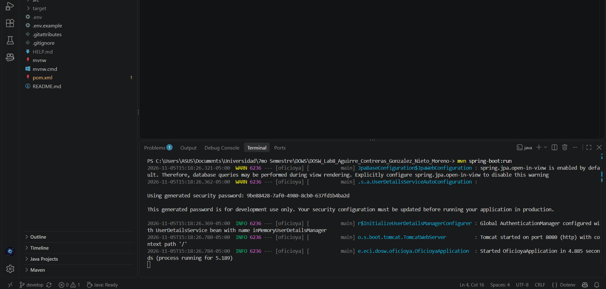

**Front iniciado.** El front arranca con `npm run dev` y Vite lo sirve en `http://localhost:5173`.

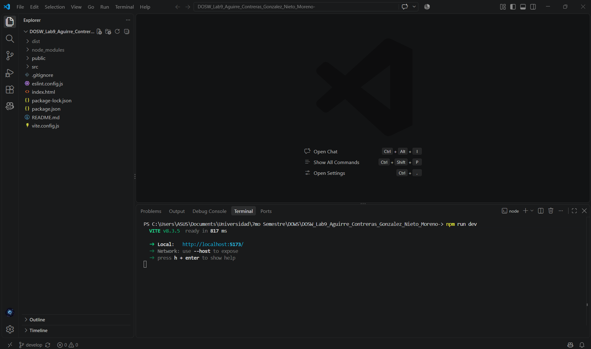

### 1. Entrar a `/solicitudes` sin sesión

Se escribe la ruta protegida `/solicitudes` sin haber iniciado sesión.

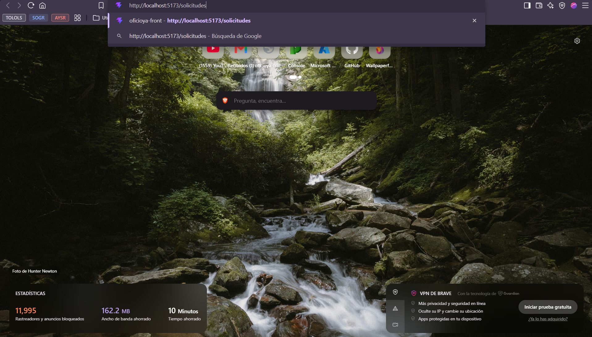

La app redirige automáticamente a `/login`: `RutaProtegida` no encuentra token.

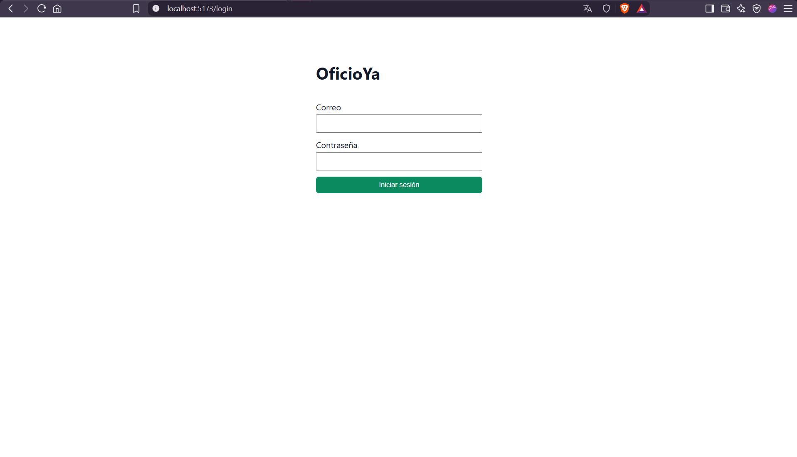

### 2. Login de Carla con contraseña errónea

Con el correo de Carla y una contraseña incorrecta, el front muestra en rojo el mensaje que envía el backend ("Credenciales inválidas") y no deja entrar.

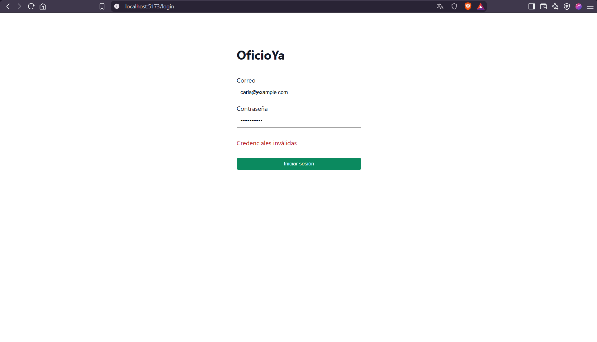

### 3. Login correcto de Carla

Formulario con las credenciales correctas de Carla.

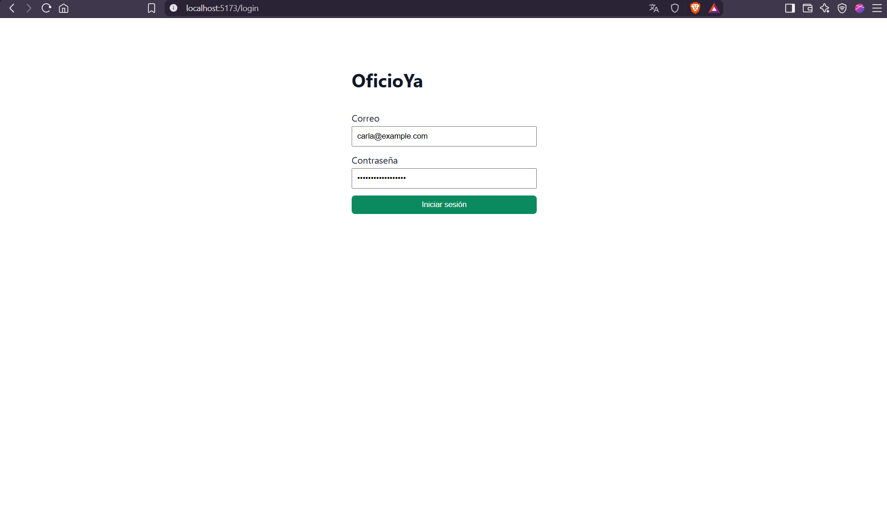

Tras el login, la app lleva a `/trabajadores`. La barra superior muestra "Carla Ruiz (CONTRATANTE)" y la lista incluye a Pedro Gomez y Maria Lopez.

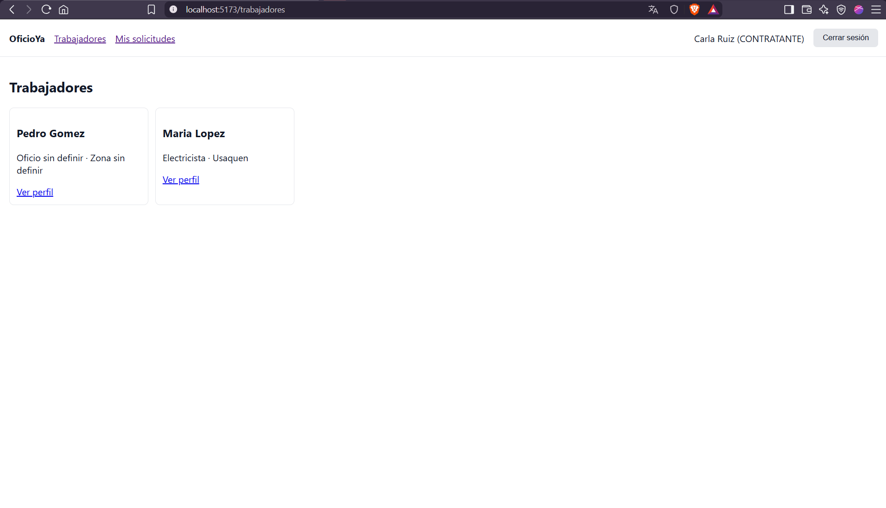

### 4. Enviar una solicitud a Pedro

En el perfil de Pedro (`/trabajadores/1`), Carla ve el formulario "Nueva solicitud" porque es `CONTRATANTE`.

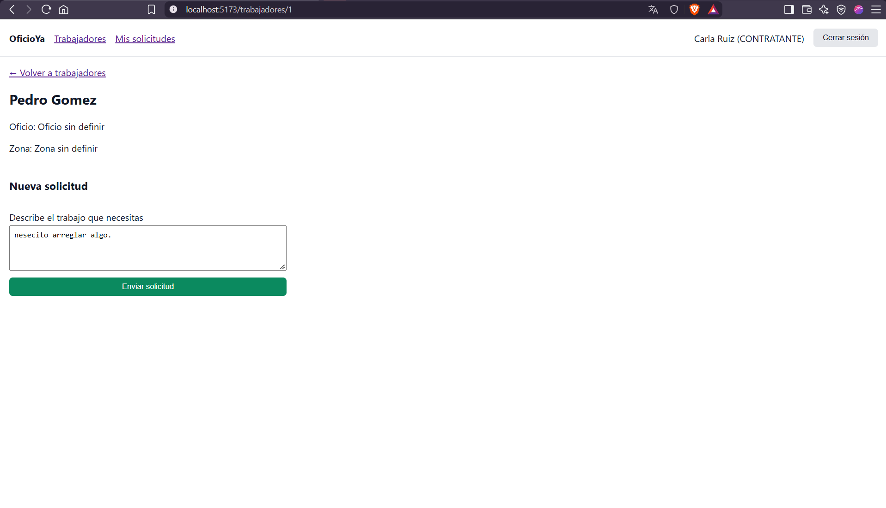

Al enviarla, la app lleva a "Mis solicitudes", donde aparece la Solicitud #1 en estado `PENDIENTE` con el botón Cancelar.

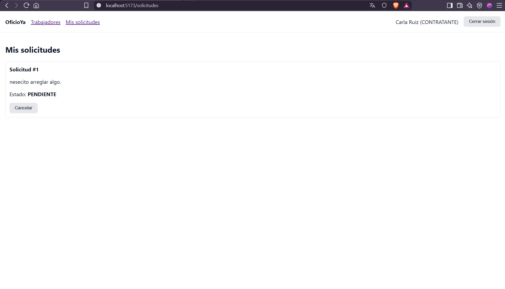

### 5. Entrar como Pedro

Se cierra la sesión de Carla y se inicia sesión con Pedro.


La barra superior muestra "Pedro Gomez (TRABAJADOR)".

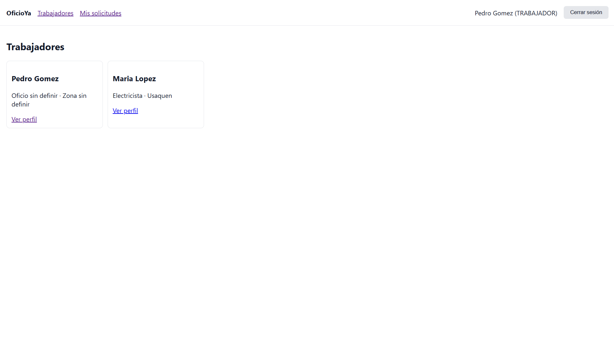

En "Mis solicitudes", Pedro ve la solicitud `PENDIENTE` con los botones Aceptar y Rechazar.

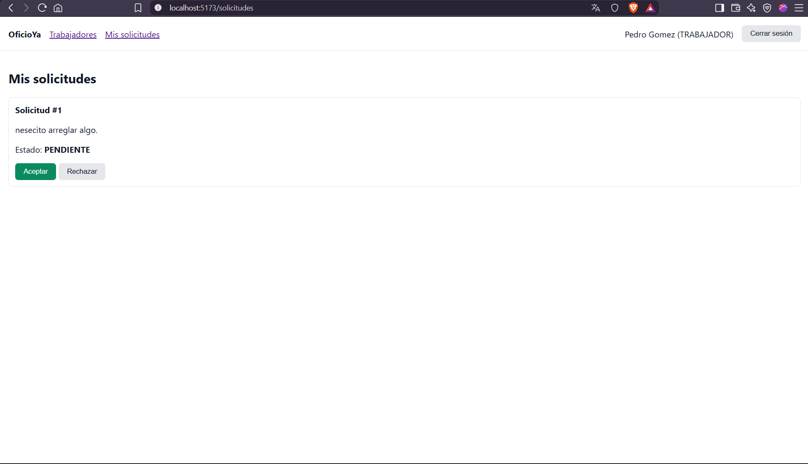

En el perfil de un trabajador, Pedro no ve el formulario de nueva solicitud: la interfaz cambia según el rol.

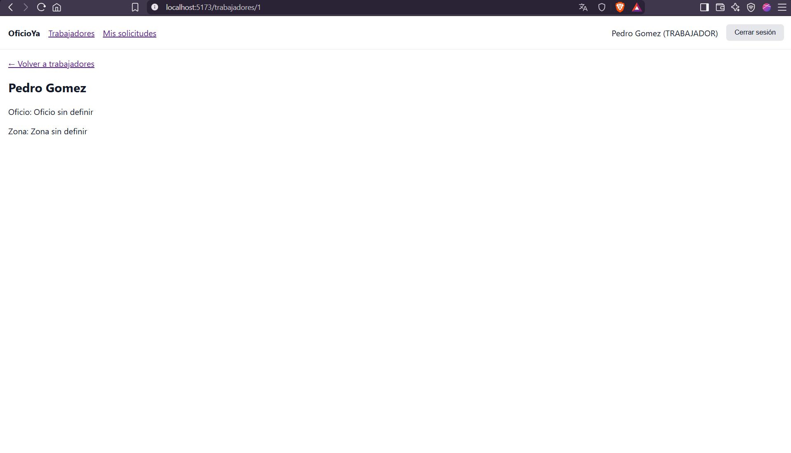

### 6. Pedro acepta la solicitud

Al pulsar Aceptar, el estado cambia a `ACEPTADA` y los botones desaparecen.

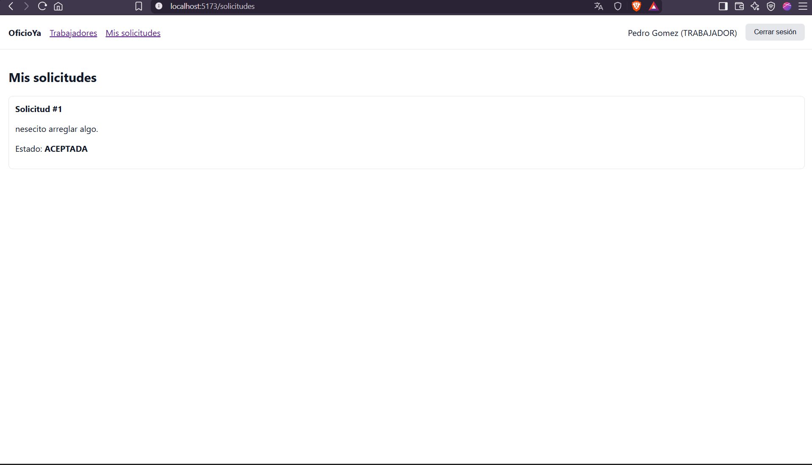

### 7. Carla cancela la solicitud

Carla ve la solicitud `ACEPTADA` con el botón Cancelar.

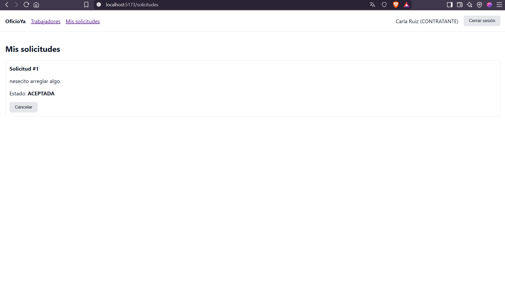

Al cancelar, el estado cambia a `CANCELADA` y el botón desaparece.

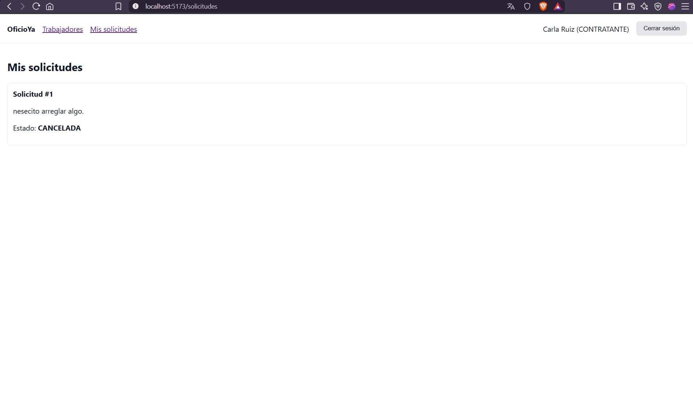

### 8. Recargar la página (F5)

Al recargar, la app vuelve a `/login`: el token vive solo en memoria y se pierde.


### 9. Encabezado `Authorization`

En las herramientas del navegador (Red → Fetch/XHR), la petición `solicitudes` lleva el encabezado `Authorization: Bearer ...` con el token JWT.

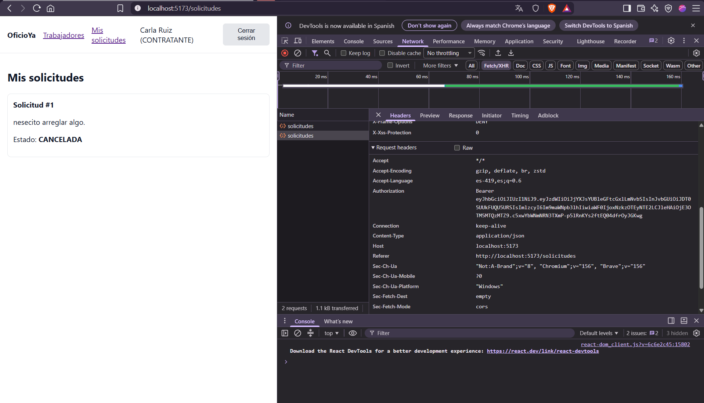